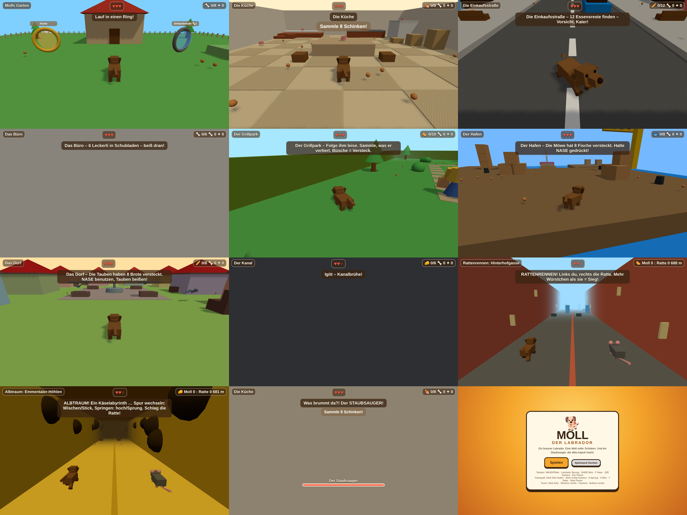

# 🐕 MOLL – Der Labrador

Low-Poly-3D-Jump'n'Run im Stil von Mario 64 / Banjo-Kazooie, gebaut mit Three.js. Man spielt Moll, einen braunen Labrador, und frisst sich durch Küche, Einkaufsstraße, Büro, Grillpark, Hafen, Dorf und Kanal. Die Bosse: Staubsauger, Kater, Dosenöffner, Möwe, Obertaube und die Ratte, die Moll in einen Albtraum aus Emmentaler schickt.



## Starten
Ohne Build-Schritt. Irgendeinen statischen Webserver im Repo-Ordner starten:
```bash
python3 -m http.server 8000
# → http://localhost:8000
```
Läuft auch direkt über GitHub Pages (Branch `main`, Ordner `/`).

## Steuerung
| | Tastatur | Gamepad | Touch |
|---|---|---|---|
| Laufen | WASD / Pfeile | linker Stick | Stick links |
| Kamera | Q / R | rechter Stick | rechts wischen |
| Sprung / Doppelsprung | Leertaste | A | SPRUNG |
| Biss | Shift / E | X | BISS |
| Nase (halten) | F | Y | NASE |
| Pause | Esc | Start | II |

Spieldesign, Welten und Roadmap stehen in [docs/GDD.md](docs/GDD.md).
