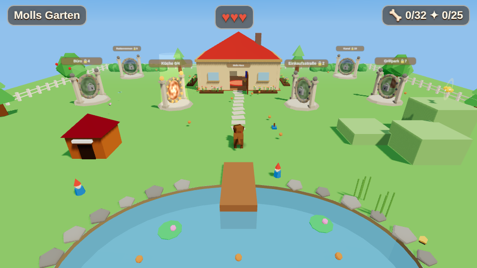
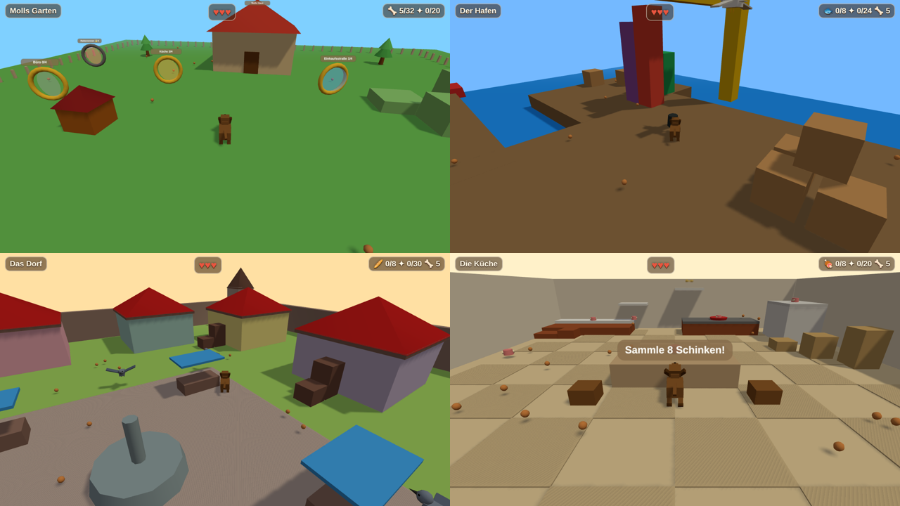

# 🐕 MOLL – Der Labrador

Low-Poly-3D-Jump'n'Run im Stil von Mario 64 / Banjo-Kazooie, gebaut mit Three.js. Man spielt Moll, einen braunen Labrador, und frisst sich durch Erdgeschoss, Einkaufsstraße, Hochhaus, Grillpark, Badestrand, Hafen, Dorf und Kanalsystem – große Welten im Banjo-Kazooie-Format mit vielen Bereichen und Ebenen. Die Bosse: Staubsauger, Kater, Dosenöffner, Möwe, Obertaube und die Ratte, die Moll in einen Albtraum aus Emmentaler schickt.



## Starten
Ohne Build-Schritt. Irgendeinen statischen Webserver im Repo-Ordner starten:
```bash
python3 -m http.server 8000
# → http://localhost:8000
```
Online spielen: **https://timo-hoen-ias.github.io/lab64/** – wird bei jedem Push auf `main` per GitHub Actions veröffentlicht (`.github/workflows/pages.yml`).

### Als App auf Android installieren
Moll64 ist eine PWA: In Chrome auf Android die Seite öffnen und im Menü auf **„App installieren“** tippen (oder auf den grünen Knopf **📲 App installieren** im Spielmenü). Die App startet dann im Vollbild und quer, läuft nach dem ersten Start auch offline (`manifest.webmanifest`, `sw.js`, `src/pwa.js`).

## Steuerung
| | Tastatur | Gamepad | Touch |
|---|---|---|---|
| Laufen | WASD / Pfeile | linker Stick | Stick links |
| Kamera | Q / R | rechter Stick | rechts wischen |
| Sprung / Doppelsprung | Leertaste | A | SPRUNG |
| Biss | Shift / E | X | BISS |
| Nase (halten) | F | Y | NASE |
| Trillern / Gleiten / Tornado | C | B | 🌀 |
| Bellen | V | RB | 📢 |
| Pause | Esc | Start | II |



**Stand:** 100 Goldknochen. Jede Welt hat 11 (die Badebucht 10), alle in **einem Besuch** zu holen (Boss, alle Krümel, Geheimversteck, Knochen in jedem Bereich und eine Fähigkeiten-Prüfung), dazu 11 im Garten und 2 im Rattenrennen.

### Fähigkeiten
Am Eingang jeder Welt wartet **Opa Bruno** (Molls alter Labrador-Opa) und bringt Moll die Fähigkeit dieser Welt bei. Die Welt ist darum gebaut, man muss nie zurück. Im Garten verkauft Opa Bruno im **Leckerli-Laden** Upgrades gegen Krümel (4. und 5. Herz, Trillern+, Lange Ohren, Supernase) – nett, aber für keinen Goldknochen nötig.

### Dialoge
Alle Figuren sprechen mit Moll – und brabbeln dabei wie in Banjo-Kazooie: Der Text erscheint Buchstabe für Buchstabe, und an jeder Silbe blubbert die eigene Stimme der Figur (tiefes Opa-Brummeln, piepsiger Zwergenkönig, Roboter-Kaffeemaschine …), alles live aus Oszillatoren, Lautstärke über den Effekte-Regler. Beim ersten Treffen gibt es ein ganzes Gespräch (Spiel hält an, SPRUNG/BISS/Tippen blättert weiter, Pause überspringt), danach nur noch kurze Sprüche nebenbei. Bosse stellen sich in Reimen vor. Texte und Stimmen: `src/dialog.js`.

### Pfoten-Geräusche
Molls Schritte klingen je nach Untergrund – Gras raschelt, Holz klopft hohl, auf Fliesen und Stein klicken die Krallen, Sand knirscht, Teppich dämpft, Blech klingt nach, in Pfützen platscht es. Die Schritte sitzen genau auf den Pfotenaufsätzen der Trab-/Galopp-Animation; Absprung und Landung (je tiefer der Sturz, desto wuchtiger) klingen ebenso nach dem Boden. Alles aus Oszillatoren und gefiltertem Rauschen (`src/audio.js`), Lautstärke über den Effekte-Regler. Den Untergrund setzen Welten mit `surface: '…'` (Welt, Raum, Kiste, Hügel, Rampe) oder `l.surface(x, z, w, d, 'tile')`; was nichts angibt, wird aus der Farbe geraten (`src/surface.js`). Test: `tests/pfoten.mjs`.

| Welt | Fähigkeit | Was sie tut | Prüfung |
|---|---|---|---|
| Garten | Apportieren | Ball/Stock mit BISS tragen und ablegen | Ball zur Hundehütte bringen |
| Erdgeschoss | Trillern | Drehung um die eigene Achse, trifft alles ringsum, zieht Krümel an | Drei Herdknöpfe, Ameisenstraßen, Staubsauger benommen wirbeln |
| Einkaufsstraße | Bellen | WUFF nach vorn: verscheucht Tauben, löst Dinge aus | Drei Autos mit Alarmanlage, Kater erschrecken |
| Hochhaus | Bauchklatscher | In der Luft BISS: senkrecht runter und stampfen | Drei Not-Aus-Knöpfe, Kartons, Dosenöffner umhauen |
| Grillpark | Buddeln | BISS an Erdhügeln | Fünf Erdhügel, in einem ein Goldknochen |
| Rattenrennen | Zoomies | Nach Vollgas-Anlauf schneller und weiter springen | Belohnung für den Sieg |
| Badebucht | Tauchen | Taucherbrille | (wie bisher) |
| Hafen | Helikopter-Ohren | In der Luft TRILLER halten = gleiten, Aufwinde tragen nach oben | Vom Ausguck zum Möwennest, Möwe aus der Luft holen |
| Dorf | Wandsprung | An Backsteinwänden abstoßen | Alter Schornstein im Zickzack hoch |
| Kanal | Tornado-Trillern | TRILLER halten bis es funkelt, loslassen: Wirbelsturm nach oben | Lüftungsschacht, Kanalratte aus der Rinne wirbeln |

| Welt | Bereiche |
|---|---|
| Garten (Hub, 160 m) | Haus, Teich zum Tauchen, Schuppen mit Werkstatt, Obstwiese mit Baumhaus, Gewächshaus, Aussichtshügel, 5 Gartenzwerge |
| Erdgeschoss | Küche, Speisekammer, Wohnzimmer mit Bücherregal, Flur mit Galerie und Standuhr, Wintergarten, Keller |
| Einkaufsstraße | Dächer-Parcours, Kaufhaus mit 3 Etagen, Baustelle, Brunnenplatz mit Fontänen, Bahnhof |
| Hochhaus | 4 Ebenen: Großraumbüro, Konferenz + Chefbüro, Serverraum + Kaffeeküche, Dach mit Antennenmast |
| Grillpark | Grillwiese, See mit Insel, Wald mit Baumkronenpfad, Spielplatz, Aussichtsturm, Dachsbau |
| Badebucht | Strand, Riff zum Tauchen, Wrack, Leuchtturm, Riesenrad, Dünen |
| Hafen | Holzkai, Containerterminal mit Kran, Fischmarkt, Mole mit Leuchtturm, Frachter mit Laderaum |
| Dorf | Marktplatz, Windmühle, Burgruine, Bauernhof mit Hühnern, Dorfteich, Bäckerei |
| Kanalsystem | Haupthalle, Pumpwerk, Rohr-Labyrinth, Klärbecken, Gully-Schacht, Rattennest |

Schnellreise-Punkte in jeder Welt, ein Kompass zeigt zum nächsten unentdeckten Punkt, die Pause zeigt alle Knochen der aktuellen Welt. Nach der Kanalratte und bei 100/100 läuft ein Abspann.

Tests (Server auf Port 8077, Playwright nötig): `node tests/worlds.mjs <ordner> hub,kueche,strasse,buero,park,hafen,dorf,kanal` spielt jede Welt in einem Besuch auf 11/11, `node tests/abilities.mjs` lernt jede Fähigkeit bei Opa Bruno und spielt sie mit und ohne durch, `node tests/strand.mjs` die Badebucht, `node tests/playtest.mjs` Rattenrennen, Albtraum und Garten, `node tests/kopf.mjs` das Kopf-Tracking zwischen Moll und NPCs, `node tests/ball.mjs` den rollenden Ball und den Ball im Maul, `node tests/dialog.mjs` Gespräche, Stimmen und Schreibmaschinen-Text. `node tests/previews.mjs` rendert die Portal-Vorschaubilder (previews/*.jpg) neu, wenn sich der Startpunkt einer Welt ändert.

Spieldesign, Welten und Roadmap stehen in [docs/GDD.md](docs/GDD.md).
